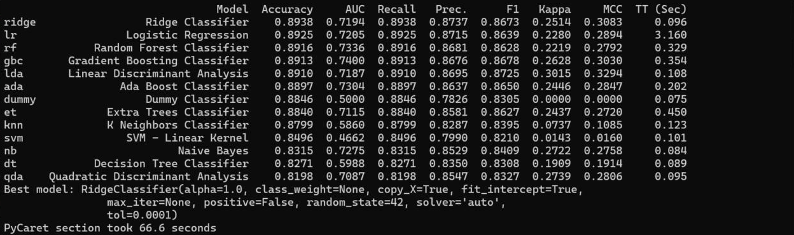
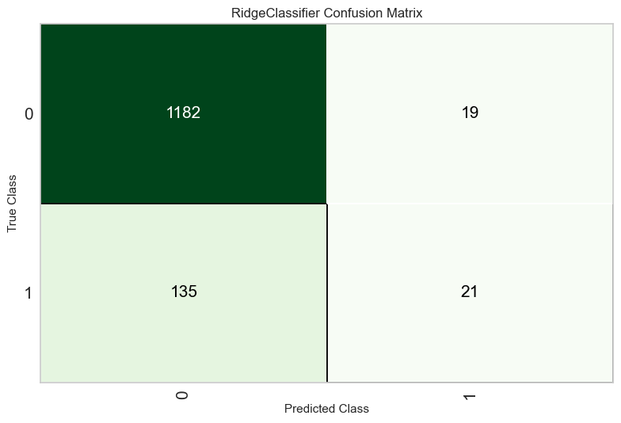
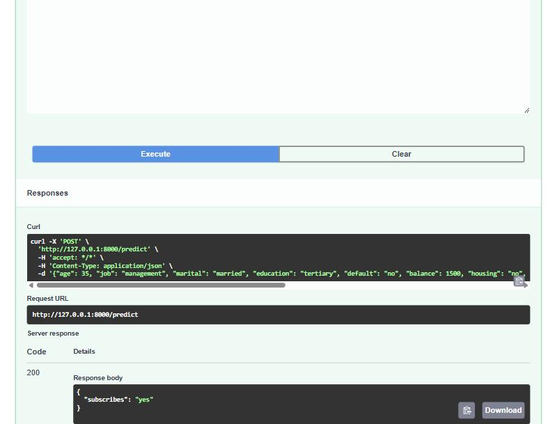

# Assignment 2: Automated ML Pipelines & Model Serving

## Business problem and dataset

A bank runs phone campaigns to sell term deposits. Predicting which clients are likely to subscribe lets the call center focus on the best leads instead of calling everyone on the list.

Dataset: [Bank Marketing, UC Irvine Machine Learning Repository](https://archive.ics.uci.edu/dataset/222/bank+marketing), saved as `data/bank.csv` (4,521 rows, the 10% sample included in the download). The target `y` is whether the client subscribed (yes/no). There are 16 features, including categorical ones such as job, marital, education, housing, loan, contact, month and poutcome.

Dropped columns:
- `duration`: the length of the call in seconds. It is only known after the call ends, so it can't be used to decide who to call (the dataset's own notes say it should be dropped for a realistic model).
- There is no ID column in this dataset, so nothing else needed to be dropped.

## How to run

```bash
uv run discovery.py
uv run fastapi dev main.py
```

`discovery.py` runs both workflows and saves `model.joblib` and `images/confusion_matrix.png`. `main.py` serves the model; open http://127.0.0.1:8000/docs to try it.

## PyCaret results



Confusion matrix for the best model (Ridge Classifier):



## Comparison

**Efficiency.** The PyCaret section took 66.6 seconds (60.9 seconds on another run), because compare_models trained 13 models with 10-fold cross-validation. The scikit-learn section took 0.1 seconds, since it trains one model once. In lines of code, PyCaret needed about 6 lines (setup, compare_models, pull and plot_model) while the scikit-learn workflow took about 20 (the split, the ColumnTransformer, the Pipeline, fitting, the report and saving). PyCaret was more efficient for finding the best model, and scikit-learn was more efficient once I knew which model to build.

**Why the scores differ.** PyCaret's Ridge Classifier scored Accuracy 0.8938, Recall 0.8938, Precision 0.8737 and F1 0.8673. Those are averages across 10 cross-validation folds on the training data, and its Recall, Precision and F1 match weighted averages over both classes (which is why Recall equals Accuracy). My classification report uses one held-out test set of 1,357 rows: accuracy 0.89, weighted precision 0.85, recall 0.89 and F1 0.86, but for the "yes" class only precision 0.53, recall 0.13 and F1 0.21. Different data and different averaging give slightly different numbers.

**Which metric matters.** Recall on "yes" matters most. Missing a client who would have subscribed is a lost sale, while an extra call costs very little. Accuracy is misleading here because 88% of clients say no, so even the Dummy Classifier gets 0.8846. My model's yes recall of 0.13 means it finds very few subscribers, so in practice I would want class weights or a lower decision threshold.

## API

A successful prediction in /docs:



Sample input:

```json
{"age": 35, "job": "management", "marital": "married", "education": "tertiary", "default": "no", "balance": 1500, "housing": "no", "loan": "no", "contact": "cellular", "day": 15, "month": "oct", "campaign": 1, "pdays": 90, "previous": 2, "poutcome": "success"}
```

Output:

```json
{"subscribes": "yes"}
```

## Explaining a prediction

I sent the same client twice and changed only `poutcome` (the outcome of the previous campaign):

| Input | Prediction |
| --- | --- |
| The sample input above with `"poutcome": "failure"` | `{"subscribes": "no"}` |
| The sample input above with `"poutcome": "success"` | `{"subscribes": "yes"}` |

This makes sense for the business. A client who said yes to the bank's last campaign has already shown they are interested, so they are much more likely to subscribe again than a client who turned the last offer down.

## AI use

I used Claude Code, an AI coding assistant, for almost all of this assignment. It picked the dataset, wrote discovery.py, main.py and this README, ran the scripts and took the screenshots, while I directed the work and reviewed the results. One thing it had to fix: the first comparison table printed with "..." hiding the middle columns, even after it set pandas display options, because PyCaret resets those settings during setup(). It changed the code to print pull().to_string() so the whole table shows.
